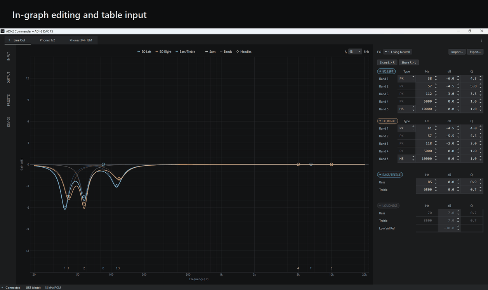

# ADI-2 Commander

A Windows app to control the RME ADI-2 DAC FS[^rme] and the outputs of the ADI-2 Pro and ADI-2/4 Pro, and to load
and convert externally generated filter sets.
A personal project, shared as is.



## Features

- **Device control:** EQ, Bass/Treble, Loudness and the output settings of Line Out, Phones and IEM. On the ADI-2 Pro
  and ADI-2/4 Pro: the same of Line Out and Phones 3/4, and of Phones 1/2 with Dual Phones on; Source, and the
  settings and the EQ of the analog input. On every model the settings of the device itself, such as its display,
  Auto Standby, DSD and the functions of its keys.
- **In-graph editing:** the EQ as a response curve, edited in place.
- **Table input:** every value entered or stepped directly, by keyboard or mouse.
- **Device-accurate curves:** curves and conversions follow the device implementation.
- **Filter set and curve conversion** from AutoEQ, squig.link, REW, Equalizer APO and others.
- **Loudness view:** what Loudness does at the current settings and volume.
- **Preset management:** preview, edit and store.
- **Simulated mode:** explore Commander with a simulated ADI-2 DAC FS, ADI-2 Pro or ADI-2/4 Pro, and convert filter
  sets and curves for any ADI-2 model.

## Also

- Save the EQ to a .txt file that is both portable and ADI-2 compatible, or as a preset file for ADI-2 Remote.
- Drag and drop filter files and curves to load them.
- Map filters one to one, or fit them for the closest possible match.
- Monitor the device's inputs and clock.
- View the curves at any sample rate, or compare them with the rate the device runs at.

## Requirements

- Windows 10 (1809) or later, 64-bit.
- An ADI-2 DAC FS, ADI-2 Pro (all versions, including EX) or ADI-2/4 Pro over USB, with MIDI Control set to ON (menu
  Remap Keys/Diag on the ADI-2 DAC FS, Device Mode on the ADI-2 Pro and ADI-2/4 Pro). Simulated mode needs no device.
- Windows' built-in USB MIDI class driver, or RME's MADIface driver (tested with 1.015).
- A 1920×1080 screen at up to 150% scaling (1280×720).

## Install

Download `ADI-2-Commander-0.1.0-setup.exe` from [Releases](../../releases) and run it. Windows may warn about an
unknown publisher: choose More info, then Run anyway.

Commander makes no internet connections and collects no data.

## Before first use

Commander keeps a copy of the device's state at each connection, presets included, in the backups folder (menu ⋮).
Restore it with ADI-2 Remote: File → Open Setup File…

Commander writes every change to the device at once. Try Simulated mode first to get to know it: start
ADI-2 Commander (simulated) from the Start menu.

## Building from source

Commander runs on Python 3.14 on Windows.

```bat
python -m venv .venv
.venv\Scripts\python -m pip install -r requirements.txt
.venv\Scripts\pythonw Commander.pyw
```

Add `--simulate` for Simulated mode. To build the installer, also install `requirements-build.txt` and Inno Setup 6,
then run `.venv\Scripts\python tools\build.py`.

## Tested with

- ADI-2 DAC FS, firmware DSP 62, USB 81
- RME MADIface driver 1.015, and Windows' built-in USB MIDI class driver
- Windows 11 Pro 26H2 (build 26300)

The ADI-2 Pro and ADI-2/4 Pro have not been tested with an actual device. Their support is built on RME's MIDI
documentation and manuals, and on how RME's ADI-2 Remote handles them.

## License

[GPL-3.0-or-later](LICENSE); the licenses of the software it includes are in the installation's licenses folder.

[^rme]: Not affiliated with or endorsed by RME, the maker of the ADI-2; both names are trademarks of their owner.
